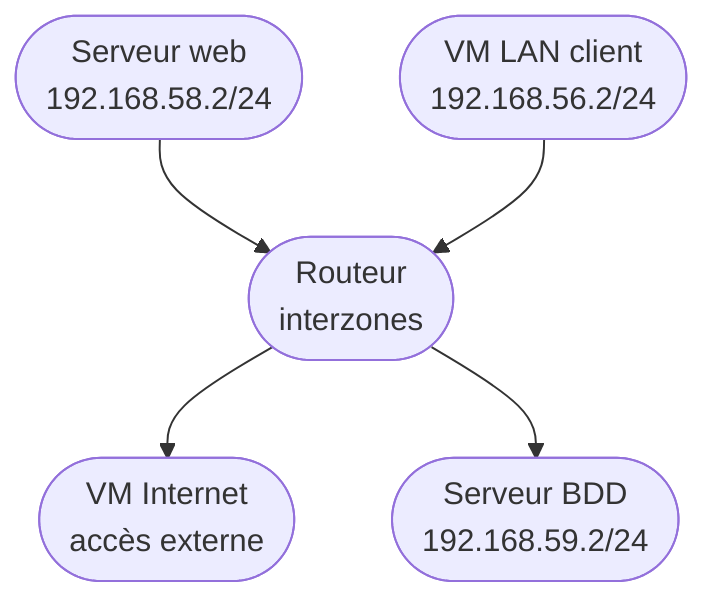

# Architecture réseau

Un routeur central interconnecte quatre VM, chacune sur son propre sous-réseau. Chaque VM dispose en plus d'une interface vers un réseau externe partagé (anonymisé ici en `192.168.60.0/24`).

Chaque lien correspond à un bridge réseau Proxmox dédié (`vmbr<x>`), reliant la VM à son interface sur le routeur.

Cette architecture correspond à celle mise en place dans le [module 2 — Protection réseau](../module-2-protection-reseau/README.md) (Web = `vm-web`, LAN = `vm-lan`, Internet = `vm-int`, BDD = `vm-sql`).
