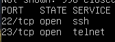
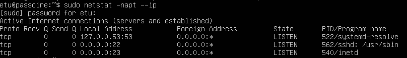
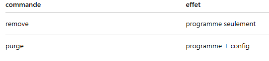
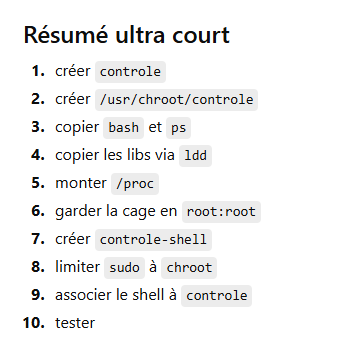
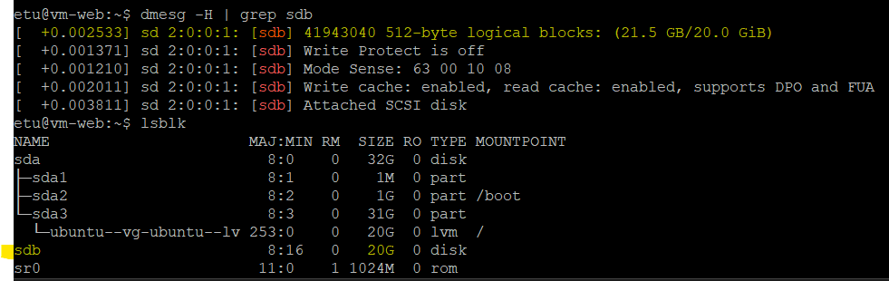
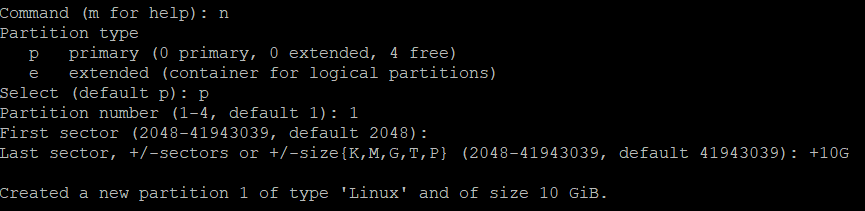
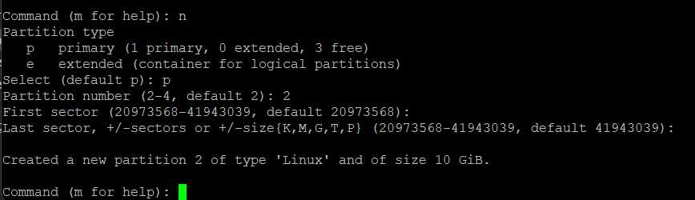
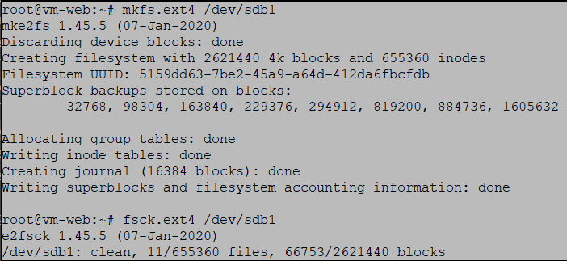

# Module 1 — Sécurité et durcissement Linux (Risque)

## Objectif

Partir d'un template Linux volontairement vulnérable (`vm-passoire`, utilisé en TD pour illustrer les mauvaises pratiques) et le transformer en deux machines durcies, `vm-cli` (poste client) et `vm-web` (serveur), en appliquant les fondamentaux de la sécurité système : identité réseau et cryptographique propre à chaque VM, gestion rigoureuse des comptes et des mots de passe, permissions strictes sur les fichiers, réduction de la surface d'attaque réseau, séparation des rôles d'administration sur le serveur web, et cloisonnement du stockage. Ce qui suit détaille, section par section, ce qui a été concrètement réalisé, d'après les notes de travail (anonymisées avant publication).

## 1. Préparation des machines virtuelles vm-cli et vm-web sous Proxmox

Objectif : cloner `vm-passoire`, renommer les VM, réinitialiser leur `machine-id`, leur donner une IP unique et régénérer leurs clés SSH — pour que chaque VM ait une identité réseau et cryptographique propre malgré une origine commune.

**Renommage et identité des VM**
```bash
sudo hostnamectl set-hostname vm-cli   # ou vm-web
# /etc/hosts n'est pas mis à jour automatiquement : édition manuelle nécessaire
sudo nano /etc/hosts

# Vérification
hostname
cat /etc/hosts
```

**Réinitialisation du machine-id**

Les VM étant des clones liés de `vm-passoire`, elles partagent au départ le même `machine-id` et les mêmes clés SSH hôte — ce qui casse leur unicité (conflits DHCP possibles, logs ambigus, risque de MITM lors d'une connexion SSH).
```bash
cat /etc/machine-id
sudo rm /etc/machine-id
sudo systemd-machine-id-setup
```

**Adresse IP unique**
```bash
ip a                 # interfaces, IP, MAC, état
sudo dhclient -r     # libère l'IP actuelle
sudo dhclient        # redemande une IP au serveur DHCP
```
Alternative envisagée : IP statique via `/etc/netplan/*.yaml` (`dhcp: no` + `addresses: [...]`), puis `sudo netplan apply`.

**Régénération des clés SSH hôte**
```bash
sudo rm /etc/ssh/ssh_host_*
sudo dpkg-reconfigure openssh-server
```
Une nouvelle paire de clés hôte est générée pour chaque VM, ce qui évite qu'un client SSH détecte un changement d'identité (alerte de type MITM) lors d'une future reconnexion légitime.

**Clés SSH utilisateur (connexion sans mot de passe)**
```bash
ssh-keygen                          # sur vm-cli
ssh-copy-id etu@<ip_vm-web>          # copie la clé publique dans ~/.ssh/authorized_keys de vm-web
```

## 2. Gestion des utilisateurs

Objectif : conserver les comptes existants (en corrigeant la configuration du compte `etu`), créer un compte privilégié par membre du groupe, supprimer les comptes de TD devenus inutiles, adopter une gestion robuste des mots de passe, corriger les anomalies de `/etc/passwd`/`/etc/shadow`, et appliquer un umask restrictif.

**Comptes privilégiés par membre**
```bash
sudo adduser <nom>
sudo usermod -aG sudo <nom>
groups <nom>          # vérification de l'appartenance au groupe sudo
```
Objectif : éviter le partage d'un compte commun, assurer la traçabilité des actions, appliquer le principe de moindre privilège.

**Suppression des comptes devenus inutiles**
```bash
sudo deluser <nom>
sudo deluser --remove-home <nom>
# vérification
grep <nom> /etc/passwd
```

> **Non détaillé dans les notes** : la suppression nominative des comptes de TD (`boule`, `remus`, `romulus`, ...) n'est pas listée précisément, et la correction spécifique attendue sur le compte `etu` n'est pas explicitée — seule la démarche générique de suppression de compte est documentée.

**Gestion robuste des mots de passe**
```bash
sudo apt install libpam-pwquality
sudo nano /etc/security/pwquality.conf
```
```
minlen=12    # longueur minimale
dcredit=-1   # au moins 1 chiffre
ucredit=-1   # au moins 1 majuscule
lcredit=-1   # au moins 1 minuscule
```
Expiration gérée via `/etc/login.defs` : renouvellement tous les 90 jours, 1 jour minimum avant un nouveau changement, alerte 7 jours avant expiration.

Protection contre la force brute :
```bash
sudo apt install fail2ban
dpkg -l | grep fail2ban
```
Fail2ban surveille les logs d'authentification et bloque automatiquement une IP après un nombre défini de tentatives échouées. En complément, l'authentification SSH par mot de passe a été désactivée dans `/etc/ssh/sshd_config` sur vm-web (connexion par clé uniquement, cf. section 1), avec limitation du nombre de tentatives et blocage de la connexion root.

Traçabilité des connexions et actions :
```bash
tail -f /var/log/auth.log
```

**Correction de /etc/passwd et /etc/shadow**
```bash
ls -l /etc/passwd /etc/shadow
sudo chmod 644 /etc/passwd
sudo chmod 640 /etc/shadow
sudo chown root:shadow /etc/passwd
```
`/etc/passwd` doit rester lisible par tous (nécessaire à de nombreux programmes) ; `/etc/shadow`, qui contient les hashs des mots de passe, doit rester strictement protégé (aucun accès pour *others*, lecture réservée au groupe `shadow`).

**Umask restrictif**
```bash
umask -S      # affichage détaillé (rwx)
umask 027     # groupe en lecture seule, aucun accès pour les autres
```
Configuration rendue permanente dans `/etc/profile` **et** `/etc/login.defs` (`USERGROUPS_ENAB no`, pour que le umask s'applique aussi à la création de compte), puis rechargement :
```bash
source ~/.profile ~/.bashrc
```

## 3. Gestion des fichiers

**Setuid : ne garder que le nécessaire**
```bash
find / -perm -4000 2>/dev/null        # liste les exécutables setuid
sudo chmod u-s /chemin/vers/executable
```
Retiré (setuid jugé inutile) : `/usr/bin/chsh`, `/usr/bin/chfn`, `/usr/bin/newgrp`, `/usr/bin/gpasswd`, `/bin/mount`, `/bin/umount`, `/usr/bin/pkexec` (faille connue). Conservé : les commandes d'administration indispensables (`su`, `sudo`, `passwd`). Les utilitaires setuid liés au réseau ont été laissés en option.

**Sticky bit**
```bash
sudo chmod +t /var/tmp /tmp
find / -type d -perm -1000 2>/dev/null                                      # répertoires avec sticky bit
sudo find / -type d \( -perm -0002 -a \! -perm -1000 \) -print 2>/dev/null  # répertoires à risque (écriture publique, sans sticky bit)
```

**Correction des anomalies de fichiers**
```bash
find / -type f -perm -o+w 2>/dev/null           # fichiers modifiables par tous → sudo chmod o-w <fichier>
find / -type f \( -nouser -o -nogroup \) -print 2>/dev/null   # fichiers orphelins → chown <user>:<user> <fichier>
ls -l /etc/shadow                               # attendu : -r-------- root shadow
ls -ld /home/*                                  # attendu : drwxr-x--- user user
```

## 4. Gestion des services réseaux

**Suppression des services inutiles ou non sécurisés**
```bash
ss -tulnp                       # services actifs et ports ouverts
sudo apt purge telnetd telnet   # port 23 supprimé
dpkg -l | grep telnet           # vérification
```




Différence `remove` vs `purge` (la seconde supprime aussi les fichiers de configuration) :



Conservés : SSH et `systemd-resolve`.

**Asymétrie du scan de ports (vm-cli → vm-web uniquement)**
```bash
sudo apt install nmap ufw
sudo ufw default deny incoming
sudo ufw allow ssh
```
Le pare-feu `ufw` est configuré côté vm-cli (refus du trafic entrant par défaut + SSH autorisé) : vm-web ne peut donc pas scanner vm-cli, alors que vm-cli conserve un accès `nmap` sortant vers vm-web (`ssh etu@vm-web`, `ssh etu@vm-cli` fonctionnels dans les deux sens par ailleurs).

## 5. Spécificités vm-cli
```bash
sudo apt install lynx
lynx http://vm-web
```
Les services non indispensables (dont telnet) avaient déjà été supprimés à l'étape 4 ; contrôle final avec `ss -tulnp`.

## 6. Spécificités vm-web

**Suppression des applications non nécessaires**

Telnet supprimé (étape 4) ; seul Apache a été ajouté au socle minimal.

**Service web**
```bash
sudo apt install apache2
sudo apt install php libapache2-mod-php
sudo systemctl restart apache2
```
Test depuis vm-cli : `lynx http://vm-web`. Logs vérifiés dans `/var/log/apache2/access.log` et `error.log` (`tail -f`).

> **Non traité dans le cadre de ce rendu** : un formulaire PHP permettant à un client de saisir des noms et de les stocker dans un fichier du serveur était prévu. Les notes ne documentent qu'un fichier de test (`testphp.php`) pour valider le fonctionnement de PHP — le formulaire de saisie/stockage proprement dit n'est pas détaillé ici (une version avec base de données est en revanche développée dans le module 2 — Protection réseau).

**Séparation des tâches**

*Compte `publie`* — peut démarrer/arrêter Apache sans être admin complet :
```bash
sudo adduser publie
sudo visudo
```
```
publie ALL=(ALL) NOPASSWD: /usr/bin/systemctl stop apache2, /usr/bin/systemctl start apache2, /usr/bin/systemctl restart apache2
```
```bash
su - publie
sudo -l                       # vérification des droits accordés
sudo systemctl restart apache2
```

*Compte `edite`* — peut modifier le contenu web sans être root, via un groupe dédié :
```bash
sudo adduser edite
sudo groupadd webedit
sudo usermod -aG webedit edite
sudo chown -R root:webedit /var/www/html
sudo chmod -R 770 /var/www/html
sudo chmod 660 /var/www/html/index.php
```
`edite` peut lire/modifier, `www-data` peut lire (et modifier via le groupe `webedit`), `root` reste administrateur. Vérification : `su - edite`, `ls -l /var/www/html`, édition du fichier avec `nano`/`vim`.

*Compte `controle`* — cage chroot, seule la commande `ps` est utilisable :
```bash
sudo useradd -d /usr/chroot/controle -s /bin/bash controle
sudo mkdir -p /var/chroot/controle/{bin,lib,lib64,proc,dev}
sudo cp /usr/bin/ps /var/chroot/bin
sudo cp /bin/bash /usr/chroot/controle/bin
ldd /usr/bin/ps /bin/bash                     # dépendances à copier dans la cage
sudo cp /lib/xxxxx.so* /var/chroot/lib/
sudo cp /lib64/xxxxx.so* /var/chroot/lib64/
sudo mount --bind /proc /usr/chroot/controle/proc   # nécessaire pour que ps fonctionne
sudo chown -R root:root /usr/chroot/controle        # la cage appartient à root, pas à controle
```
Shell de connexion dédié, qui redirige automatiquement dans la cage :
```bash
sudo nano /usr/local/bin/controle-shell
```
```bash
exec sudo /usr/sbin/chroot /usr/chroot/controle /bin/bash
```
```bash
sudo chmod 755 /usr/local/bin/controle-shell
sudo chsh -s /usr/local/bin/controle-shell controle
```
Autorisation sudo limitée au strict nécessaire (`/etc/sudoers.d/controle-chroot`, droits 440) :
```
controle ALL=(ALL) NOPASSWD: /usr/sbin/chroot /usr/chroot/controle /bin/bash
```
Test : `su controle` → seule la commande `ps` fonctionne, toute autre commande (`ls`, `cd`, ...) échoue.



**Surveillance**
```bash
tail -f /var/log/apache2/access.log   # IP client, date, méthode HTTP, chemin, code retour, user-agent
tail -f /var/log/apache2/error.log
sudo tcpdump -n -i ens18 'port 80' -X
```
La capture confirme l'absence de chiffrement sur HTTP (contenu des requêtes/réponses visible en clair) et permet d'observer en direct les échanges entre client (`lynx http://vm-web` depuis vm-cli) et serveur.

**Séparation des espaces de stockage et montage restrictif (optionnel GI04+)** — traité
```bash
dmesg -H | grep sdb
lsblk
sudo fdisk /dev/sdb          # création de 2 partitions (/var, /home), 10 Go chacune
sudo mkfs.ext4 /dev/sdb1
sudo mkfs.ext4 /dev/sdb2
sudo fsck.ext4 /dev/sdb1
sudo fsck.ext4 /dev/sdb2
```








```bash
sudo mkdir /mnt/newvar /mnt/newhome
sudo mount /dev/sdb1 /mnt/newvar
sudo mount /dev/sdb2 /mnt/newhome
sudo rsync -aXS /var/ /mnt/newvar/
sudo rsync -aXS /home/ /mnt/newhome/
sudo blkid /dev/sdb1 /dev/sdb2
sudo nano /etc/fstab
```
```
UUID=abcd-1234   /var   ext4   defaults,nosuid,nodev,noexec   0 2
UUID=efgh-5678   /home  ext4   defaults,nosuid,nodev,noexec   0 2
```
```bash
sudo mv /var /var.old && sudo mv /home /home.old
sudo mkdir /var /home
sudo mount -a
sudo reboot

df -h        # /dev/sdb1 → /var, /dev/sdb2 → /home
lsblk
```
`rsync -aXS` a été préféré à `cp -a` pour préserver en une seule passe l'ensemble des attributs (permissions, dates, liens). Les options de montage limitent les risques : `nosuid` (ignore les bits setuid/setgid), `nodev` (interdit les fichiers spéciaux), `noexec` (interdit l'exécution de binaires sur ces partitions).

> **Non confirmé dans les notes** : un snapshot de la VM avant cette étape était prévu par précaution ; les notes ne mentionnent pas explicitement sa prise avant l'ajout du disque.

---

## Récapitulatif rapide des commandes

```bash
# Utilisateurs
adduser <nom> / usermod -aG <groupe> <nom> / deluser <nom>

# Permissions
chmod 640 <fichier> / chmod 770 <dossier> / chown <user>:<groupe> <fichier>
find / -perm -4000 2>/dev/null     # setuid
chmod +t <dossier>                 # sticky bit

# SSH
ssh-keygen / ssh-copy-id user@ip
nano /etc/ssh/sshd_config && systemctl restart ssh

# Fail2ban
apt install fail2ban / fail2ban-client status sshd

# Réseau
ss -tulnp / nmap <ip> / ufw enable / ufw allow 22

# Apache
apt install apache2 / systemctl restart apache2

# Chroot
chroot /chemin /bin/bash / ldd /bin/<commande>

# Disque
fdisk /dev/sdb / mkfs.ext4 /dev/sdb1 / mount /dev/sdb1 /var / df -h
```
