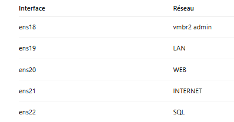
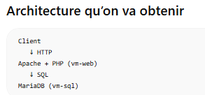
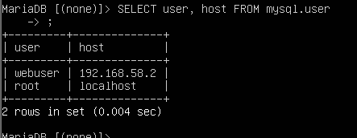
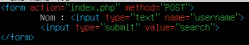
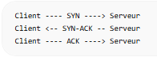

# Module 2 — Protection réseau

## Objectif

Faire évoluer l'infrastructure du module 1 vers une architecture réseau segmentée en 4 zones de confiance — **LAN** (`vm-lan`), **INTERNET** (`vm-int`), **WEB** (`vm-web`, DMZ) et **SQL** (`vm-sql`, DMZ), reliées par un routeur filtrant (`vm-router`) — avec une politique de sécurité par défaut restrictive : tout est bloqué sauf ce qui est explicitement nécessaire à l'application web (présentation → PHP → base de données), déclinée en une version vulnérable et une version sécurisée pour illustrer les bonnes pratiques. Ce qui suit détaille, section par section, ce qui a été concrètement réalisé, d'après les notes de travail (anonymisées avant publication).

## 1. Création des machines virtuelles et des réseaux

Objectif : mettre en place 5 VM (`vm-lan`, `vm-int`, `vm-web`, `vm-sql`, `vm-router`) — `vm-lan`/`vm-int` clonées de `vm-cli` (module 1), `vm-web`/`vm-sql` réutilisant/clonant le travail du module 1 (avec correction des failles héritées de `vm-passoire` et suppression des logiciels inutiles) — reliées par des réseaux dédiés.

**Adressage et routage (base commune aux VM et au routeur)**
```bash
sudo nano /etc/netplan/00-installer-config.yaml   # IPv4/IPv6 statique, DHCP désactivé sur l'interface
sudo netplan apply
ip a                                               # vérification de l'adressage
ip route                                           # table de routage
```
Une route statique est ajoutée entre `vm-cli` et le serveur applicatif via le routeur (`to` = IP de la VM cible, `via` = IP du routeur).

**Table de correspondance interfaces ↔ réseaux** (routeur) :

| Interface | Réseau |
|---|---|
| ens18 | vmbr2 (admin) |
| ens19 | LAN |
| ens20 | WEB |
| ens21 | INTERNET |
| ens22 | SQL |



> **Non détaillé dans les notes** : le clonage/renommage explicite des 5 VM, la correction nommée des failles héritées de `vm-passoire` sur `vm-lan`/`vm-int`, et la création du compte dédié pour lancer phpMyAdmin à la demande (sur le modèle du compte `publie` du module 1) ne sont pas documentés — seule la configuration réseau de base (adressage, routage) est détaillée.

## 2. Sécurisation de l'application web

Architecture 3 tiers : présentation (page + style, servie par Apache sur `vm-web`), application (PHP sur `vm-web`), données (MariaDB sur `vm-sql`).



**Sécurisation de MariaDB (vm-sql)**
```bash
sudo mysql_secure_installation
sudo mysql
```
```sql
CREATE DATABASE protection_db;
USE protection_db;

CREATE TABLE users (
    id  INT AUTO_INCREMENT PRIMARY KEY,
    nom VARCHAR(50)
);

-- Compte dédié à l'application (jamais root), restreint à l'IP de vm-web,
-- droit SELECT uniquement — principe de moindre privilège
CREATE USER 'webuser'@'192.168.58.2' IDENTIFIED BY 'ChangeMe123!';
GRANT SELECT ON protection_bdd.* TO 'webuser'@'192.168.58.2';
FLUSH PRIVILEGES;

-- Vérification / retrait des droits
SHOW GRANTS FOR 'webuser'@'192.168.58.2';
REVOKE ALL PRIVILEGES ON protection_bdd.* FROM 'webuser'@'192.168.58.2';
```

```bash
sudo nano /etc/mysql/mariadb.conf.d/50-server.cnf   # bind-address = 192.168.59.2 (écoute sur le réseau SQL)
sudo systemctl restart mariadb
ss -tulnp                                           # vérification du bind-address
```
Test d'accès depuis vm-web :
```bash
sudo apt install mariadb-client
mysql -u webuser -p -h 192.168.59.2 protection_db
```

**Application web (vm-web)**
```bash
sudo apt install apache2 php libapache2-mod-php php-mysql -y
dpkg -l | grep php                       # vérification des paquets déjà présents
sudo apt install mariadb-client -y       # client SQL côté vm-web
```
Deux versions de l'application, dans deux dossiers distincts pour être accessibles via deux URL différentes :
```bash
sudo mkdir -p /var/www/html/vulnerable
sudo mkdir -p /var/www/html/secure
sudo chown -R www-data:www-data /var/www/html/vulnerable
sudo chown -R www-data:www-data /var/www/html/secure
sudo nano /var/www/html/vulnerable/index.php
```
Le formulaire de présentation (nom du client → requête) :
```html
<form action="index.php" method="POST">
    Nom : <input type="text" name="username">
    <input type="submit" value="search">
</form>
```


Version **vulnérable** : la valeur saisie est concaténée directement dans la requête SQL, sans échappement (injection SQL possible) :
```php
$sql = "SELECT * FROM users WHERE nom='$username'";
```

Vérifications :
```bash
sudo tail -n 20 /var/log/apache2/error.log
php -l /var/www/html/vulnerable/index.php   # vérification syntaxique du fichier PHP
```

> **Non traité dans le cadre de ce rendu** : une seconde version *sécurisée* (protégée contre l'injection SQL, par ex. avec des requêtes préparées) était prévue en complément de la version vulnérable. Les notes ne montrent que la création du dossier `secure` (vide) — le code de la version sécurisée n'y est pas détaillé.

> **Non traité dans le cadre de ce rendu (partie facultative)** : l'analyse des deux versions avec `phpcs` (php-codesniffer) et `nikto`, avec un compte dédié restreint à ces commandes, n'apparaît pas dans les notes.

## 3. Configuration du routage et du filtrage

**Remise à zéro et politique par défaut restrictive (sur vm-router)**
```bash
sudo iptables -F                # supprime toutes les règles actuelles
sudo iptables -t nat -F         # idem pour la table NAT (redirections, masquage)
sudo iptables -X                # supprime les chaînes personnalisées

sudo iptables -P INPUT DROP     # tout ce qui arrive sur le routeur est bloqué par défaut
sudo iptables -P FORWARD DROP   # tout ce qui traverse le routeur est bloqué par défaut
sudo iptables -P OUTPUT ACCEPT  # le routeur peut émettre ses propres paquets

sudo iptables -A INPUT -i lo -j ACCEPT                                         # loopback
sudo iptables -A INPUT -m conntrack --ctstate ESTABLISHED,RELATED -j ACCEPT    # réponses aux connexions déjà établies
sudo iptables -A FORWARD -m conntrack --ctstate ESTABLISHED,RELATED -j ACCEPT  # idem pour le trafic traversant
```

**SSH uniquement depuis vmbr2**
```bash
sudo iptables -A INPUT -i ens18 -p tcp --dport 22 -j ACCEPT
```

**Connexions autorisées**
```bash
# vm-lan → vm-web (HTTP + SSH)
sudo iptables -A FORWARD -i ens19 -o ens20 -s 192.168.56.0/24 -d 192.168.58.2 -p tcp -m multiport --dport 80,22 -j ACCEPT

# vm-lan → vm-sql (SSH)
sudo iptables -A FORWARD -i ens19 -o ens22 -s 192.168.56.0/24 -d 192.168.59.2 -p tcp --dport 22 -j ACCEPT

# vm-web → vm-sql (MariaDB, port 3306) — obligatoire pour que l'appli PHP interroge la base
sudo iptables -A FORWARD -i ens20 -o ens22 -s 192.168.58.2 -d 192.168.59.2 -p tcp --dport 3306 -j ACCEPT

# vm-int → vm-web (HTTP uniquement)
sudo iptables -A FORWARD -s 192.168.57.0/24 -d 192.168.58.2 -i ens21 -o ens20 -p tcp --dport 80 -j ACCEPT
```

**Connexions interdites**
```bash
# Rien n'atteint vm-lan
sudo iptables -A FORWARD -o ens19 -d 192.168.56.0/24 -j DROP

# vm-int ne peut pas atteindre vm-sql
sudo iptables -A FORWARD -i ens21 -o ens22 -s 192.168.57.0/24 -d 192.168.59.2 -j DROP
```

Tests réalisés :
```bash
# Autorisé
ssh etu@192.168.58.2                                     # vm-lan → vm-web
ssh etu@192.168.59.2                                      # vm-lan → vm-sql
mysql -h 192.168.59.2 -u webuser -p protection_bdd        # vm-web → vm-sql

# Interdit (vérifié depuis vm-int)
ssh etu@192.168.59.2                                       # échoue
mysql -h 192.168.59.2 -u webuser -p protection_bdd         # échoue
```

**Protection contre le SYN-Flood (vm-web)**



```bash
# Protection noyau (SYN cookies)
sudo sysctl -w net.ipv4.tcp_syncookies=1
sudo nano /etc/sysctl.conf        # décommenter net.ipv4.tcp_syncookies=1 pour la persistance au reboot
sudo sysctl -p

# Limitation au niveau du pare-feu
sudo iptables -I INPUT 3 -p tcp --syn -m limit --limit 10/s --limit-burst 20 -j ACCEPT
sudo iptables -A INPUT -p tcp --syn -j DROP     # tout SYN au-delà de la limite est rejeté
sudo iptables -L INPUT -n --line-numbers -v     # vérification de l'ordre des règles
```
Un SYN-Flood envoie un grand nombre de paquets SYN sans terminer la connexion, saturant les connexions semi-ouvertes du serveur. La combinaison SYN cookies (noyau) + limitation iptables (pare-feu) traite le problème aux deux niveaux.

**Protection contre le scan de ports (vm-web)**
```bash
# NULL scan (aucun flag TCP) — nmap -sN
sudo iptables -A INPUT -p tcp --tcp-flags ALL NONE -j DROP
# XMAS scan (tous les flags actifs) — nmap -sX
sudo iptables -A INPUT -p tcp --tcp-flags ALL ALL -j DROP
# FIN scan (uniquement le flag FIN) — nmap -sF
sudo iptables -A INPUT -p tcp --tcp-flags ALL FIN -j DROP
```
Tests :
```bash
sudo nmap -sN 192.168.58.2
sudo nmap -sX 192.168.58.2
sudo nmap -sF 192.168.58.2
```

**Accès de vm-int à vm-web via le port 8080 du routeur (DNAT), sans accès direct**
```bash
sudo iptables -t nat -A PREROUTING -i ens21 -p tcp -d 192.168.57.254 --dport 8080 -j DNAT --to-destination 192.168.58.2:80
sudo iptables -A FORWARD -i ens21 -o ens20 -s 192.168.57.0/24 -d 192.168.58.2 -p tcp --dport 80 -m conntrack --ctorigdstport 8080 -j ACCEPT
```
Tests depuis vm-int :
```bash
lynx http://192.168.57.254:8080    # OK — accès via le routeur
lynx http://192.168.57.254         # échoue (pas de service sur le port 80 du routeur)
lynx http://192.168.58.2           # échoue (pas d'accès direct à vm-web)
lynx http://192.168.58.2:8080      # échoue (le DNAT ne cible que l'IP du routeur)
```

**Masquage des accès vm-lan → vm-int par l'IP du routeur (SNAT/MASQUERADE)**
```bash
sudo nano /etc/sysctl.conf        # net.ipv4.ip_forward=1
sudo iptables -t nat -A POSTROUTING -o ens21 -s 192.168.56.0/24 -d 192.168.57.0/24 -j MASQUERADE
sudo iptables -A FORWARD -i ens19 -o ens21 -s 192.168.56.0/24 -d 192.168.57.0/24 -j ACCEPT
```
Vérification : `sudo tcpdump -i ens21` sur le routeur pendant un `lynx http://<ip_vm-int>` depuis vm-lan — la source observée est l'IP du routeur, pas celle de vm-lan.

**Persistance et vérification des règles**
```bash
sudo apt install iptables-persistent -y
sudo netfilter-persistent save
sudo cat /etc/iptables/rules.v4

# Vérification des compteurs (doivent augmenter avec le trafic réel)
sudo iptables -L FORWARD -n -v
sudo iptables -t nat -L -n -v
```

## 4. Serveur DNS (GI04+)

Objectif : retrouver le serveur web de la DMZ par son nom plutôt que par son adresse IP.

```bash
sudo apt install bind9
sudo nano /etc/bind/named.conf.local
```
```
zone "dmz.lab" {
    type master;
    file "/etc/bind/db.dmz.lab";
};
```
```bash
sudo cp /etc/bind/db.local /etc/bind/db.dmz.lab
sudo nano /etc/bind/db.dmz.lab
```
```
ns  IN A 192.168.58.3   ; associe ns.dmz.lab  à 192.168.58.3
web IN A 192.168.58.2   ; associe web.dmz.lab à 192.168.58.2
```
```bash
sudo named-checkzone dmz.lab /etc/bind/db.dmz.lab
sudo named-checkconf
sudo tail -n 20 /var/log/syslog
```
Configuration du client DNS (`vm-lan`/`vm-int`) :
```bash
sudo nano /etc/resolv.conf     # nameserver 192.168.58.2
```
Filtrage DNS (UDP/53), en gardant une politique de refus par défaut :
```bash
# Sur le routeur : autoriser vm-int et vm-lan → serveur DNS de la DMZ WEB
sudo iptables -A FORWARD -p udp -i ens21 -o ens20 -s 192.168.57.0/24 -d 192.168.58.2 --dport 53 -j ACCEPT
sudo iptables -A FORWARD -p udp -i ens19 -o ens20 -s 192.168.56.0/24 -d 192.168.58.2 --dport 53 -j ACCEPT

# Sur vm-web : autoriser les requêtes DNS entrantes depuis le LAN et l'INTERNET interne
sudo iptables -A INPUT -i ens19 -s 192.168.56.0/24 -p udp --dport 53 -j ACCEPT
sudo iptables -A INPUT -i ens19 -s 192.168.57.0/24 -p udp --dport 53 -j ACCEPT
```
Test : `nslookup web.dmz.lab` (résout en `192.168.58.2`) depuis un client, vérification des compteurs avec `iptables -L -n -v` sur le routeur et sur vm-web.

---

## Récapitulatif rapide des commandes

```bash
# Réseau / routage
ip a / ip route / netplan apply

# Pare-feu (base)
iptables -F / iptables -P INPUT DROP / iptables -P FORWARD DROP
iptables -A INPUT -m conntrack --ctstate ESTABLISHED,RELATED -j ACCEPT

# NAT
iptables -t nat -A PREROUTING ... -j DNAT --to-destination <ip>:<port>
iptables -t nat -A POSTROUTING ... -j MASQUERADE

# Anti SYN-Flood
sysctl -w net.ipv4.tcp_syncookies=1
iptables -I INPUT 3 -p tcp --syn -m limit --limit 10/s -j ACCEPT

# Anti scan de ports
iptables -A INPUT -p tcp --tcp-flags ALL NONE -j DROP   # NULL scan
iptables -A INPUT -p tcp --tcp-flags ALL ALL -j DROP    # XMAS scan
iptables -A INPUT -p tcp --tcp-flags ALL FIN -j DROP    # FIN scan

# MariaDB
CREATE USER 'user'@'ip' IDENTIFIED BY '***';
GRANT SELECT ON db.* TO 'user'@'ip';

# DNS
apt install bind9 / named-checkzone <zone> <fichier> / nslookup <nom>
```
