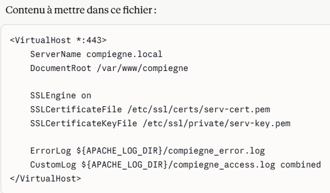
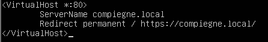
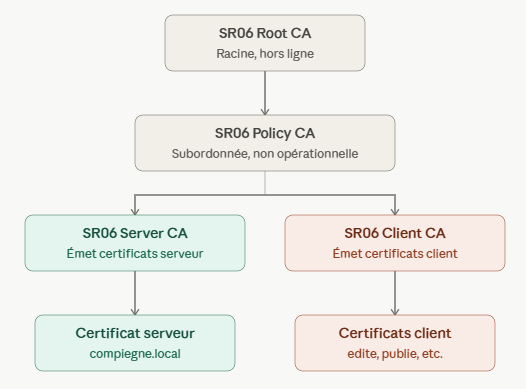
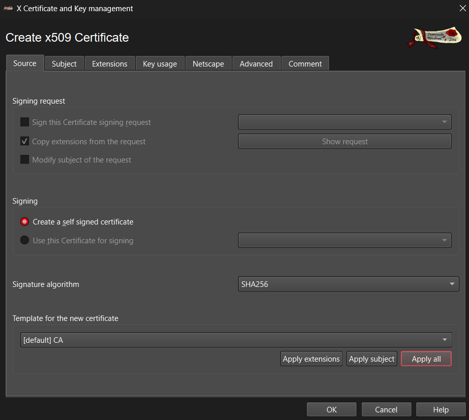
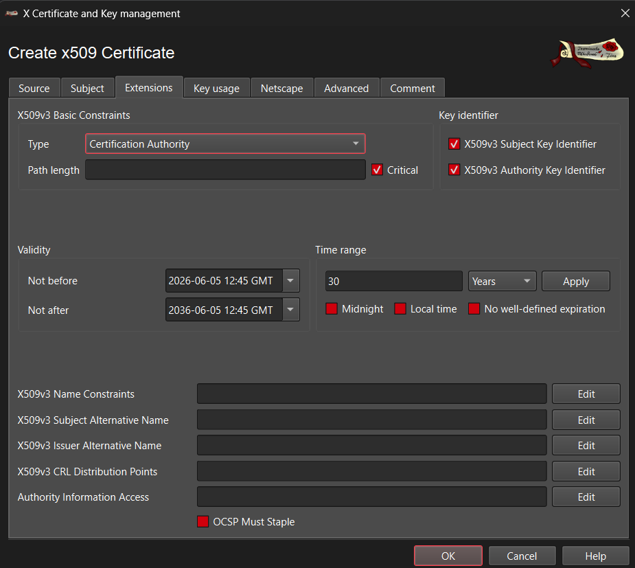
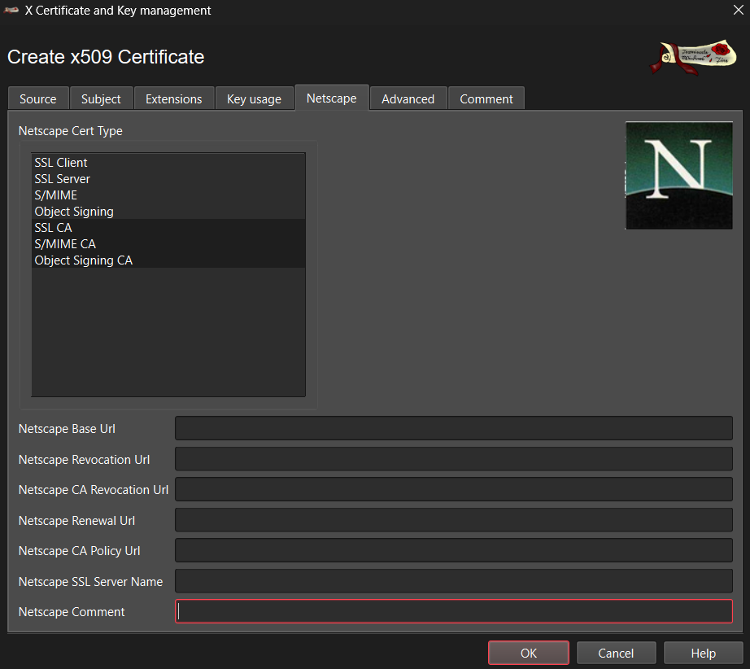
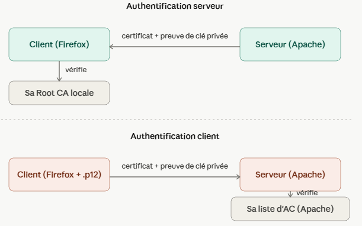

# Module 3 — Cryptographie

## Objectif

Compléter l'infrastructure des modules précédents en protégeant les données au repos et les échanges : chiffrer le `/home` de `vm-web` avec LUKS, remplacer les mots de passe par une authentification SSH par clé, faire passer le serveur web en HTTPS, puis déployer une PKI X.509 complète (avec XCA) pour authentifier mutuellement client et serveur et gérer la révocation de certificats. Ce qui suit détaille, section par section, ce qui a été concrètement réalisé, d'après les notes de travail (anonymisées avant publication).

## 1. Répertoire home de vm-web (chiffrement LUKS)

Objectif : vérifier que `/home` est sur une partition dédiée (héritée du module 1), la chiffrer avec LUKS, et vérifier le fonctionnement via l'utilisateur `edite`.

```bash
df -h && lsblk                       # état des partitions avant intervention

# Sauvegarde du contenu actuel de /home
sudo mkdir -p /root/home-backup
sudo cp -a /home/. /root/home-backup/
sudo diff -rq /home/ /root/home-backup/     # vérification de la sauvegarde

# Démontage et outillage LUKS
sudo apt-get install cryptsetup
sudo umount /home

# Formatage et ouverture du volume chiffré
sudo cryptsetup luksFormat /dev/sdb2
sudo cryptsetup luksOpen /dev/sdb2 home_crypt

# Système de fichiers sur le volume déchiffré, puis restauration des données
sudo mkfs.ext4 /dev/mapper/home_crypt
sudo mount /dev/mapper/home_crypt /home
sudo cp -a /root/home-backup/. /home

# Vérification
df -h
lsblk
sudo cryptsetup luksDump /dev/sdb2
```
LUKS chiffre les données brutes de la partition ; ext4, créé par-dessus, organise ensuite ces données en fichiers et dossiers. `/home` était déjà sur sa partition dédiée `/dev/sdb2` depuis le module 1 (Risque).

> **Non détaillé dans les notes** : une vérification dédiée était prévue — `edite` stockant des données dans son répertoire personnel chiffré avant de les mettre à disposition sur le serveur web — mais elle n'apparaît pas comme un test distinct ; seule la restauration générale du contenu de `/home` après chiffrement est documentée.

## 2. Services réseaux sur vm-web

Objectif : ne garder que SSH sur vm-web (suppression telnet, vérification nmap/netstat — traité au module 1), configurer HTTPS, générer des bi-clés depuis `etu` sur vm-cli pour les utilisateurs de vm-cli, et vérifier une connexion SSH sans mot de passe ainsi que l'exécution de commandes à distance pour `edite` et `publie`.

**Bi-clés SSH pour edite et publie (connexion sans mot de passe)**
```bash
# Depuis le compte etu sur vm-cli
ssh-keygen -t rsa -b 3072 -f ~/edit_key
ssh-keygen -t rsa -b 3072 -f ~/publie_key

# Déploiement des clés publiques sur vm-web
ssh-copy-id -i ~/edit_key.pub edite@192.168.58.2
ssh-copy-id -i ~/publie_key.pub publie@192.168.58.2

# Vérification : connexion sans mot de passe + exécution de commande à distance
ssh -i ~/edit_key edite@192.168.58.2 hostname
```
Les clés déployées se retrouvent dans `~/.ssh/authorized_keys` de chaque compte sur vm-web. L'option `-i` est nécessaire car ces clés ne sont pas dans l'emplacement par défaut (`~/.ssh/id_rsa`) mais directement dans le répertoire personnel de `etu`.

**Configuration HTTPS (Apache, vm-web)**

Chaîne de confiance minimale construite manuellement avec `openssl`, avant l'architecture complète à base de XCA (section 3) :
```bash
mkdir ~/HTTPS && cd ~/HTTPS

# Clé et certificat auto-signé de l'autorité racine
openssl genrsa -out root-key.pem 4096
openssl req -x509 -new -key root-key.pem -sha256 -days 600 -out root-cert.pem

# Clé et CSR du serveur
openssl genrsa -out serv-key.pem 2048
openssl req -new -key serv-key.pem -out serv-csr.pem

# Signature du certificat serveur par la racine
openssl x509 -req -in serv-csr.pem -CA root-cert.pem -CAkey root-key.pem \
    -CAcreateserial -days 60 -sha256 -out serv-cert.pem
```
Déploiement dans Apache :
```bash
sudo cp serv-key.pem /etc/ssl/private
sudo cp serv-cert.pem /etc/ssl/certs
sudo nano /etc/apache2/sites-available/labweb.conf
```
```
<VirtualHost *:443>
    ServerName lab.local
    SSLEngine on
    SSLCertificateFile /etc/ssl/certs/serv-cert.pem
    SSLCertificateKeyFile /etc/ssl/private/serv-key.pem
</VirtualHost>
```

```bash
sudo a2enmod ssl
sudo a2ensite labweb.conf
sudo systemctl reload apache2.service
```
Redirection HTTP → HTTPS (port 80 vers 443) :
```
<VirtualHost *:80>
    ServerName lab.local
    Redirect permanent / https://lab.local/
</VirtualHost>
```


`lab.local` a été ajouté dans `/etc/hosts` pour que le `Common Name` du certificat corresponde au nom utilisé pour se connecter — sans quoi le client TLS signale une incohérence (Firefox/lynx) entre l'adresse demandée et l'identité présentée par le certificat.

Vérification par capture réseau :
```bash
sudo tcpdump -i ens19 -w capture.pcap
```

## 3. Déploiement d'une architecture de confiance (XCA)

Objectif : construire une chaîne de confiance à 3 niveaux, avec ségrégation par usage entre authentification serveur et authentification client (un certificat client ne doit jamais dépendre de la même AC d'émission qu'un certificat serveur, même s'ils partagent une racine commune).

```
SR06 Root CA (racine, hors ligne, auto-signée)
      │
SR06 Policy CA (subordonnée, non opérationnelle)
      │
      ├── SR06 Server CA  → émet le certificat serveur (lab.local)
      └── SR06 Client CA  → émet les certificats client (edite, publie)
```



La racine est créée en auto-signé dans XCA (aucune AC supérieure ne peut la signer) :



Root CA et Policy CA n'émettent jamais de certificat final ; elles ne servent qu'à construire et signer le niveau du dessous. Seules Server CA et Client CA sont opérationnelles au quotidien.

**Profils de certificats appliqués** :

| Profil | Key Usage (critique) | Extended Key Usage | Basic Constraint |
|---|---|---|---|
| AC (Root / Policy / Server / Client CA) | CRL Sign, Certificate Sign | — | CA = TRUE |
| Authentification serveur | Digital Signature, Key Encipherment | TLS Web Server Authentication | — |
| Authentification client | Digital Signature, Key Encipherment | TLS Web Client Authentication | — |



**Génération d'un certificat final (flux type, exécuté sur la machine concernée)**
```bash
openssl genrsa -out cle.pem 2048
openssl req -new -key cle.pem -out csr.pem
```
La CSR est ensuite importée dans XCA (onglet *Requêtes de signature de certificat* → *Importer*), signée par l'AC appropriée (Server CA ou Client CA selon le cas), en réglant les onglets *Source* (algorithme, signataire), *Extensions* (type = Entité finale, durée de validité) et *Usage de la clé* (Key Usage critique, Extended Key Usage non critique). L'onglet *Netscape*, hérité d'anciens usages, a été laissé désactivé :



**Export vers vm-web et construction de la chaîne**
```bash
scp SR06_Root_CA.crt SR06_Policy_CA.crt SR06_Server_CA.crt SR06_Client_CA.crt etu@192.168.58.2:~/
# sur vm-web
mkdir ~/PKI && mv ~/SR06_*.crt ~/PKI/
cat server-cert.pem SR06_Server_CA.crt SR06_Policy_CA.crt > server-chain.pem
```
`server-chain.pem` (certificat + AC intermédiaires, sans la racine) est ce qu'Apache envoie réellement au client TLS, pour qu'il puisse reconstruire le chemin de confiance jusqu'à la racine qu'il connaît déjà.

**Vérification systématique après chaque signature**
```bash
openssl x509 -in cert.pem -noout -text     # Issuer/Subject, Validity, extensions
openssl req -in csr.pem -noout -text       # idem pour une requête non signée
openssl s_client -connect lab.local:443 -showcerts   # chaîne envoyée par le serveur ; Verify return code
```

**Import de la racine dans Firefox** : *Autorités* → importer `SR06_Root_CA.crt`, cocher *Identifier des sites web* — résout l'alerte `SEC_ERROR_UNKNOWN_ISSUER` initiale.

## 4. Utilisation de l'architecture de confiance



**Authentification client par certificat (vm-web)**
```bash
cat SR06_Client_CA.crt SR06_Policy_CA.crt SR06_Root_CA.crt > client-ca-chain.pem
sudo cp client-ca-chain.pem /etc/ssl/certs/
sudo vim /etc/apache2/sites-available/labweb.conf
```
```
SSLCACertificateFile /etc/ssl/certs/client-ca-chain.pem
SSLVerifyClient require
SSLVerifyDepth 3
```
`SSLCACertificateFile` liste les AC en lesquelles Apache a confiance pour valider un certificat client ; `SSLVerifyClient require` rend ce certificat obligatoire pour accéder au site.

Côté client, le certificat signé (`edite-cert.pem` + clé + chaîne) est packagé en PKCS#12 pour import dans Firefox :
```bash
openssl pkcs12 -export -in edite-cert.pem -inkey edite-key.pem -certfile client-chain.pem -out edite.p12
```
Import Firefox : *Vos certificats* → importer `edite.p12`, ce qui permet à Firefox de présenter cette identité lors d'une demande d'authentification client.

**Contrôle de CRL (révocation)**
```bash
# Révocation de edite dans XCA, puis export/transfert de la CRL vers vm-web
openssl crl -in client-ca.crl -noout -text     # émetteur, dates, certificats révoqués (n° de série)

sudo cp client-ca.crl /etc/ssl/crl/
sudo vim /etc/apache2/sites-available/labweb.conf
```
```
SSLCARevocationFile /etc/ssl/crl/client-ca.crl
SSLCARevocationCheck chain
```
`SSLCARevocationCheck chain` force Apache à vérifier le statut de révocation de tous les certificats de la chaîne du client, pas seulement le certificat final. Point important retenu dans les notes : **Firefox ne consulte jamais lui-même la CRL** d'une AC client — il continue de proposer un certificat révoqué sans broncher. C'est entièrement Apache, côté serveur, qui porte la responsabilité du contrôle de révocation.

## 5. Signature

Objectif prévu : éditer un document depuis `etu` sur vm-cli, le transférer dans le répertoire chiffré de `edite` sur vm-web, signer ce document avec la PKI en tant que `edite`, puis le publier sur le serveur web.

> **Non traité dans le cadre de ce rendu.** Les notes couvrent la signature et la vérification de fichiers avec `openssl rsautl -sign` / `-verify` à titre d'exercice général (TD), mais ne documentent pas ce scénario spécifique (document réel, transfert vers le répertoire chiffré de `edite`, signature avec les clés de la PKI du projet, publication du contrat signé).

## 6. Vérifications

**Fonctionnement du serveur web depuis un client Firefox** — couvert : import de la Root CA (résout `SEC_ERROR_UNKNOWN_ISSUER`), import du certificat client `.p12`, accès HTTPS fonctionnel avec cadenas.

> **Non confirmé dans les notes** : une vérification explicite qu'un client possédant un certificat révoqué ne peut plus s'authentifier était prévue. La configuration de la vérification de CRL (section 4) est faite et expliquée, mais un test concret confirmant le rejet effectif du certificat révoqué de `edite` n'est pas documenté.

> **Non traité dans le cadre de ce rendu** : récupération du document signé et vérification de sa signature — conséquence directe de la section 5 (signature) non traitée.

---

## Récapitulatif rapide des commandes

```bash
# LUKS
cryptsetup luksFormat /dev/sdbX / cryptsetup luksOpen /dev/sdbX <nom>
mkfs.ext4 /dev/mapper/<nom> / cryptsetup luksDump /dev/sdbX

# SSH par clé
ssh-keygen -t rsa -b 3072 -f <fichier>
ssh-copy-id -i <fichier>.pub user@host
ssh -i <fichier> user@host <commande>

# PKI (openssl)
openssl genrsa -out cle.pem 2048
openssl req -new -key cle.pem -out csr.pem
openssl req -x509 -new -key cle.pem -days N -out cert.pem        # auto-signé (racine)
openssl x509 -req -in csr.pem -CA ca.pem -CAkey ca-key.pem -CAcreateserial -out cert.pem
openssl x509 -in cert.pem -noout -text                           # inspection
openssl s_client -connect host:443 -showcerts                    # diagnostic TLS

# PKCS#12 (Firefox)
openssl pkcs12 -export -in cert.pem -inkey cle.pem -certfile chain.pem -out fichier.p12

# CRL
openssl crl -in ca.crl -noout -text

# Apache HTTPS
a2enmod ssl / a2ensite <site>.conf / apache2ctl configtest
# SSLEngine on / SSLCertificateFile / SSLCertificateKeyFile
# SSLCACertificateFile / SSLVerifyClient require / SSLVerifyDepth N
# SSLCARevocationFile / SSLCARevocationCheck chain
```
